# S2 mesh pipeline: benchmark on public CT label maps

Research use, not for diagnosis or surgical planning.

Generated by `scripts/ctmesh_benchmark.py`. Software: emgmirror.ctmesh 0.1.0, python 3.13.18, platform linux-x86_64, numpy 2.5.3, scipy 1.18.1, vtk 9.7.2, trimesh 5.2.1, manifold3d 3.5.5, meshoptimizer 0.2.30a0, highdicom 0.29.0, pydicom 3.0.2, SimpleITK 2.5.8. Machine: 4-core cloud container, no GPU.

Data: ground-truth label maps of public TotalSegmentator subjects (Zenodo 6802613, v3.0.0, CC BY 4.0), converted to the S1 contract by `emgmirror.ctmesh.fixtures.totalseg_to_contract`. The dataset is resampled to 1.5 mm isotropic, so anisotropic grids are covered by the phantom tests and the tuning table, not here. Every number is measured against the label's exact voxel boundary (HD95 and mean surface distance both directions; volume vs voxel count).

## Per subject

| subject | study (meta.csv) | grid (z,y,x) | structures | QC passed | new runtime (s) | old meshing (s, 4 proc) | print / web triangles | old triangles | combined_web.glb | bones meeting acceptance |
|---|---|---|---|---|---|---|---|---|---|---|
| s0040 | ct chest-abdomen-pelvis | 421x291x291 | 108 | 108/108 | 121 | 26 | 2,906,476 / 814,300 | 2,907,274 | 4.4 MB | 56/56 |
| s1641 | ct head | 111x151x151 | 5 | 5/5 | 36 | 9 | 293,604 / 85,226 | 351,732 | 0.4 MB | 3/3 |
| s1051 | ct neck | 129x181x181 | 38 | 38/38 | 25 | 7 | 397,980 / 294,214 | 398,436 | 1.6 MB | 22/22 |
| s1444 | ct lower limb | 114x129x129 | 4 | 4/4 | 8 | 3 | 50,632 / 50,632 | 50,752 | 0.3 MB | 4/4 |
| s0230 | ct heart-thorakale aorta | 217x221x221 | 80 | 80/80 | 64 | 13 | 1,493,652 / 800,164 | 1,496,534 | 4.2 MB | 46/46 |
| s0119 | ct abdomen-pelvis | 343x293x293 | 82 | 82/82 | 104 | 21 | 2,561,920 / 816,658 | 2,563,498 | 4.3 MB | 37/37 |
| s0482 | ct spine | 265x241x241 | 93 | 93/93 | 70 | 14 | 1,389,576 / 829,058 | 1,392,178 | 4.4 MB | 52/52 |
| s0035 | ct upper limb both | 145x320x320 | 62 | 62/62 | 48 | 10 | 1,070,064 / 799,944 | 1,070,538 | 4.1 MB | 38/38 |
| s1094 | ct angiography neck-thx-abd-pelvis-leg | 183x227x227 | 79 | 79/79 | 59 | 11 | 1,250,292 / 813,020 | 1,252,556 | 4.2 MB | 45/45 |
| s1152 | ct polytrauma | 548x333x333 | 114 | 114/114 | 184 | 40 | 3,239,076 / 941,836 | 3,359,380 | 5.1 MB | 61/61 |

New pipeline time by stage, all subjects together (s): surfacenets_all 67, meshes_lods_qc 339, export_meshes 246, dicom_seg 52, total 719. `meshes_lods_qc` includes the full QC of every LOD (distance, self-intersection, manifold checks).

## Old vs new, all structures

| pipeline | HD95 median / max (mm) | mean distance median (mm) | abs volume change median / max (%) | watertight | with self-intersections | HD95 <= 1 voxel (1.5 mm) | triangles |
|---|---|---|---|---|---|---|---|
| old `ct/mesh.py` | 0.77 / 1.51 | 0.28 | 0.21 / 100.0 | 653/665 | 8/665 | 664/665 | 14,842,878 |
| new `ctmesh` (print LOD) | 0.75 / 0.93 | 0.28 | 0.19 / 7.5 | 665/665 | 0/665 | 665/665 | 14,653,272 |

Web LOD: HD95 median 0.78 mm, max 1.00 mm (display gate 1.5 voxel = 2.25 mm).

Surface method per structure: SurfaceNets 570, flying edges 79, flying edges on a contact-bridged mask 1, exact voxel boundary (1-2 voxel fragments) 15; 665 in total. Fallbacks are chosen only when the SurfaceNets surface fails QC, is thin, or changes volume by more than 10 %.

Structures failing the QC gate: 0.

## Bone accuracy acceptance (proposal)

Criteria (REGULATORY_PATH.md section 4, proposal): mean surface distance <= 1.0 mm and HD95 <= 2.0 mm against the label boundary, laterality consistent (left/right pairs on the correct side in LPS). Scale is exact by construction and checked on every run (`self_checks.glb_units`; hazard tests HAZ02). This measures **mesh fidelity to the label map**, not segmentation accuracy against the patient: that needs S1 and an independent clinical dataset.

Bones evaluated: 364 across 10 subjects. Passed: 364. Failed: 0.

Worst bone mean distance 0.32 mm, worst bone HD95 0.89 mm. Laterality: 214 paired bones consistent, 0 inconsistent.

Every structure, with pass/fail: [S2_mesh_structures.csv](S2_mesh_structures.csv).

## Before / after renders

Left: old `ct/mesh.py` output on the same labels (binary marching cubes, Taubin 20, decimation), converted to the same frame and colours. Right: new `combined_web.glb` as a viewer receives it (meshopt + quantised), loaded by three.js GLTFLoader + MeshoptDecoder in headless Chromium. Same lights and camera.

**s0040 - all - anterior** (triangles shown: old 2,907,274, new 814,300)

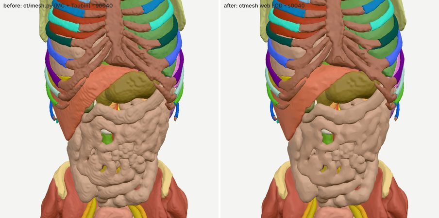

**s0040 - vertebrae_L1 - anterior** (triangles shown: old 15,384, new 7,278)

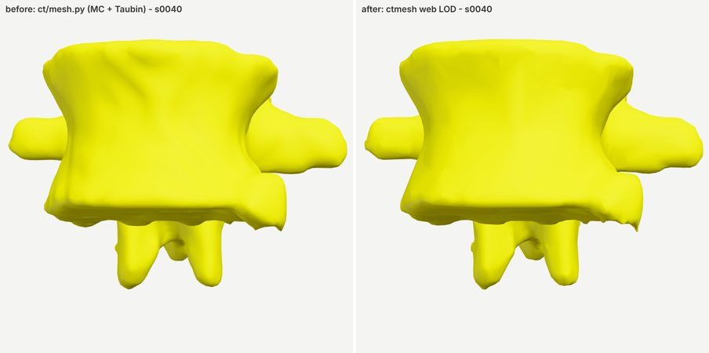

**s0040 - vertebrae_L1 - left** (triangles shown: old 15,384, new 7,278)

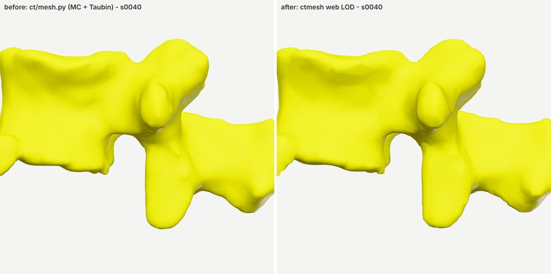

**s0040 - hip_left - anterior** (triangles shown: old 71,728, new 14,170)

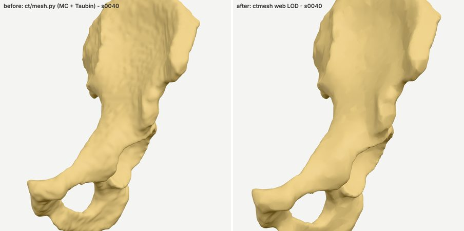

**s0040 - hip_left - left** (triangles shown: old 71,728, new 14,170)

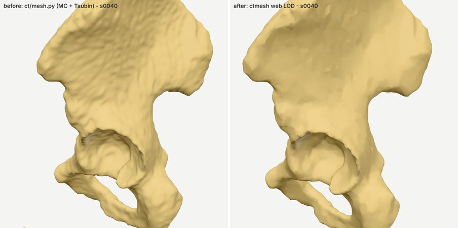

**s1641 - all - anterior** (triangles shown: old 351,732, new 85,226)

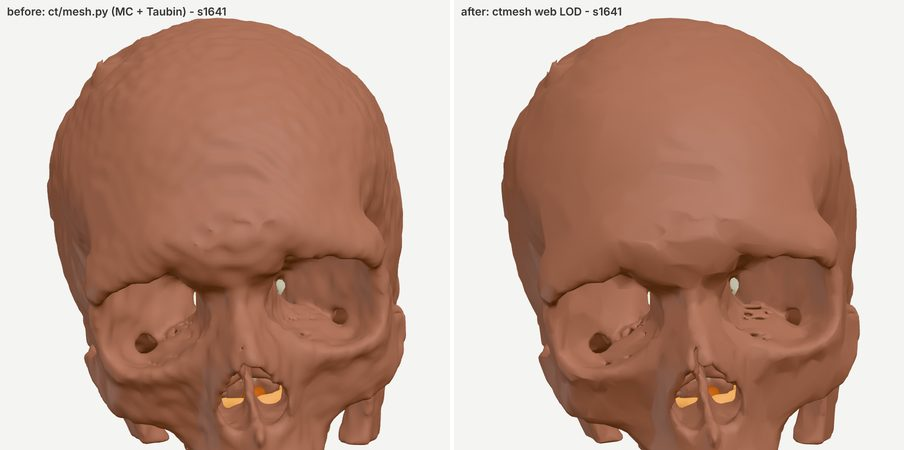

**s1641 - skull - anterior** (triangles shown: old 258,130, new 44,906)

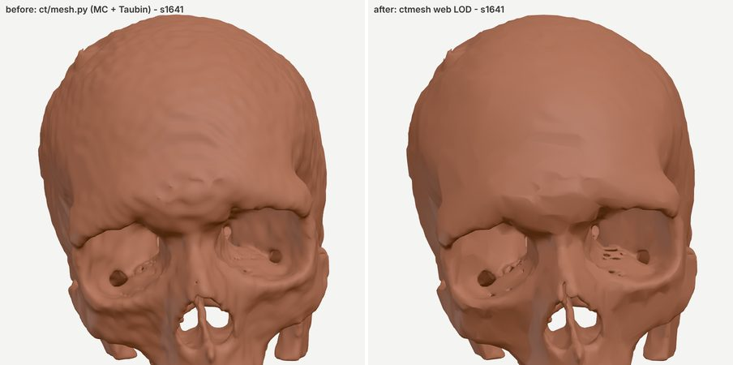

**s1641 - skull - left** (triangles shown: old 258,130, new 44,906)

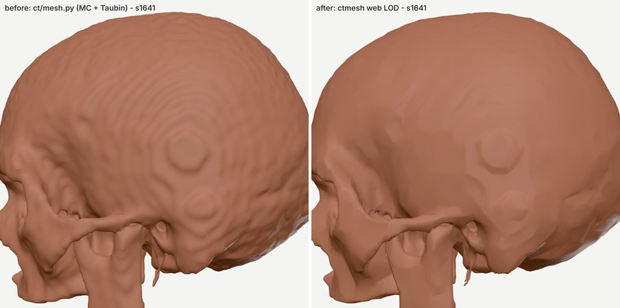

**s1051 - all - anterior** (triangles shown: old 398,436, new 294,214)

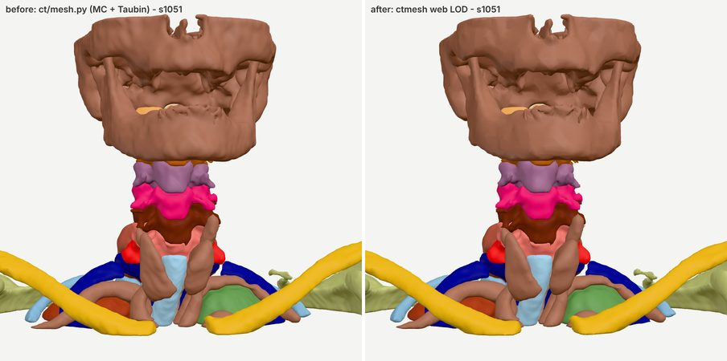

**s1444 - all - anterior** (triangles shown: old 50,752, new 50,632)

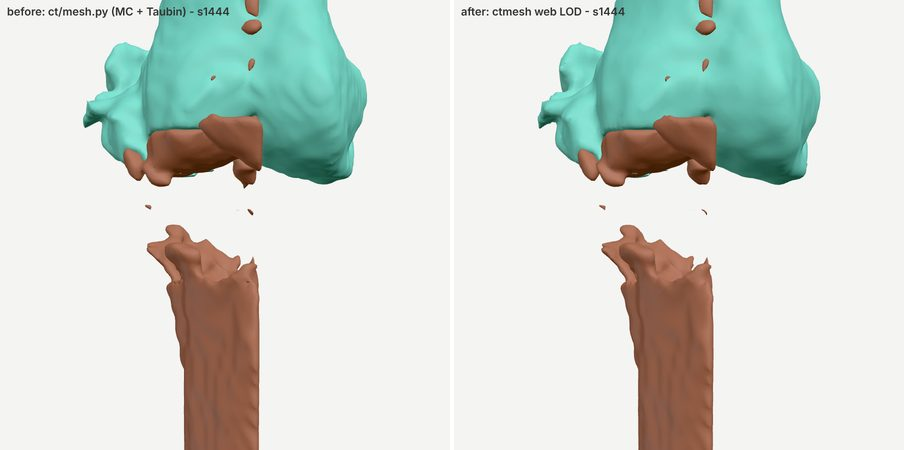

**s0230 - all - anterior** (triangles shown: old 1,496,534, new 800,164)

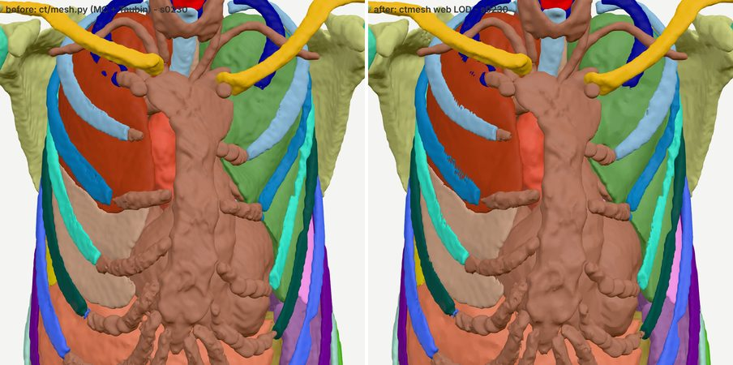

**s0230 - heart - anterior** (triangles shown: old 96,624, new 23,392)

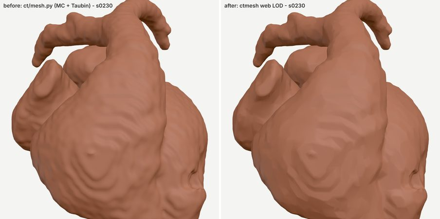

**s0230 - heart - left** (triangles shown: old 96,624, new 23,392)

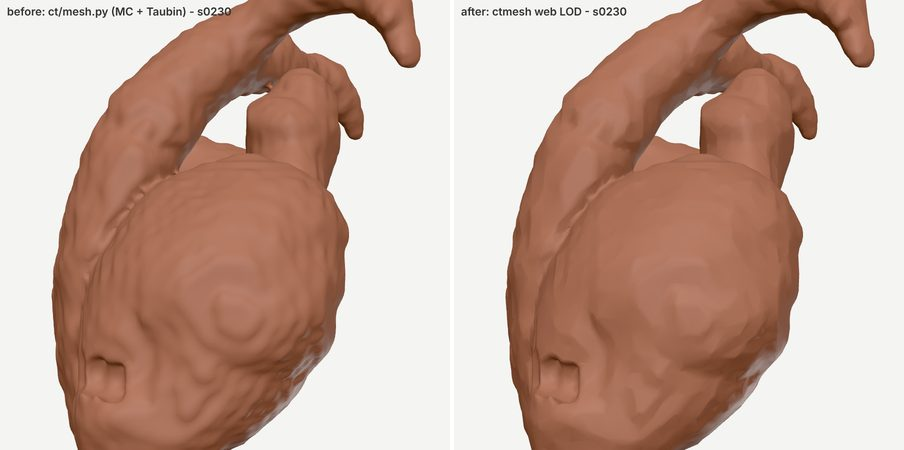

**s0119 - all - anterior** (triangles shown: old 2,563,498, new 816,658)

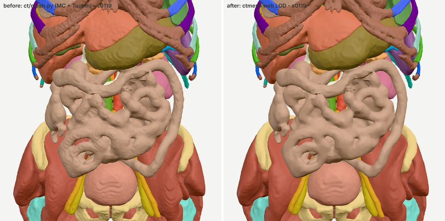

**s0482 - all - anterior** (triangles shown: old 1,392,178, new 829,058)

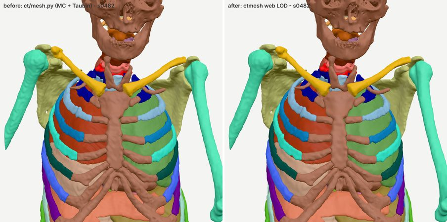

**s0035 - all - anterior** (triangles shown: old 1,070,538, new 799,944)

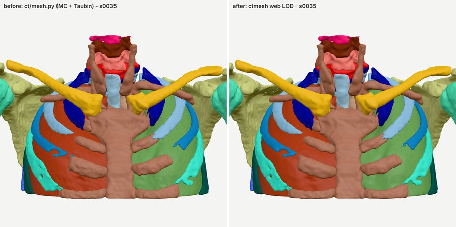

**s0035 - humerus_left - anterior** (triangles shown: old 93,874, new 63,536)

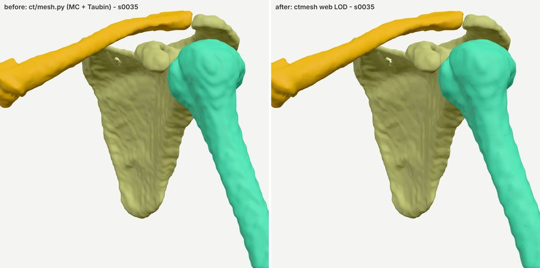

**s0035 - humerus_left - left** (triangles shown: old 93,874, new 63,536)

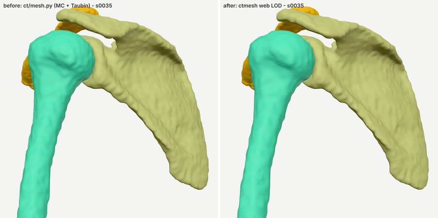

**s1094 - all - anterior** (triangles shown: old 1,252,556, new 813,020)

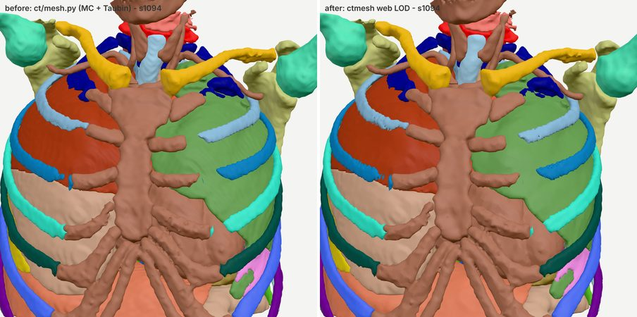

**s1152 - all - anterior** (triangles shown: old 3,359,380, new 941,836)

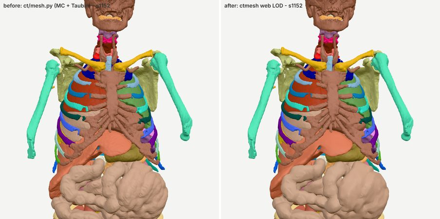

## Chosen defaults and the measurements behind them

Defaults (`SurfaceParams`, `PipelineParams`):

| setting | value | why |
|---|---|---|
| extraction | `vtkSurfaceNets3D`, all labels in one run, built-in smoother **off** | its smoother shrank volume by 6-11 % on a smooth ellipsoid and 28-68 % on a thin tube (table below) |
| smoothing | windowed sinc, pass band 0.1, 50 iterations, **per label** | non-shrinking; per label avoids pinning at multi-label junctions (below) |
| constraint | each vertex moves at most 0.45 voxel per grid axis | < 0.5 voxel: the two faces of a one-voxel-thick feature cannot cross; 0 self-intersecting labels |
| fallback | flying edges + windowed sinc (30 it, pass band 0.1); exact voxel boundary for volume problems; contact-bridged mask as last resort | chosen only when the primary surface fails QC, is thin, or changes volume > 10 % |
| print LOD | <= 200,000 triangles per structure, error cap 0.25 voxel | most structures stay native |
| web LOD | <= 30,000 per structure, whole scene <= 800,000, error cap 0.5 voxel | about 4-5 MB per body scan |
| QC limit | HD95 <= 1 voxel (geometric mean of the spacing) for print, 1.5 voxel for web | brief: "HD95 <= 1 voxel" |

**Analytic shapes** (`python scripts/ctmesh_tune.py`): a rotated ellipsoid (axes 18/13/10 mm) and a tilted tube with a 1.6 mm wall, voxelised by 4x supersampling. RMS and normal error are against the true analytic ellipsoid surface.

| grid (mm) | setting | ellipsoid RMS to true surface (mm) | ellipsoid normal error mean / p95 (deg) | ellipsoid dV vs voxels (%) | ellipsoid HD95 vs label (mm) | thin tube dV (%) | thin tube HD95 (mm) | self-intersecting pairs | watertight | time (s) |
|---|---|---|---|---|---|---|---|---|---|---|
| 1.5x1.5x1.5 | SurfaceNets, no smoothing (voxel boundary) | 0.65 | 44.4 / 76 | +0.0 | 0.00 | -1.0 | 0.03 | 0 | no | 0.02 |
| 1.5x1.5x1.5 | SurfaceNets built-in smoother, VTK defaults (16 it, automatic constraints) | 0.51 | 2.4 / 6 | -10.6 | 1.08 | -67.7 | 1.64 | 0 | no | 0.02 |
| 1.5x1.5x1.5 | SurfaceNets built-in smoother, 50 it, constraint 0.5 voxel | 0.36 | 16.3 / 35 | -5.6 | 0.74 | -35.0 | 0.69 | 0 | no | 0.02 |
| 1.5x1.5x1.5 | SurfaceNets + windowed sinc pb 0.05 / 30 it, clamp 1.0 voxel | 0.14 | 4.6 / 9 | +0.2 | 0.74 | -28.4 | 0.67 | 0 | no | 0.02 |
| 1.5x1.5x1.5 | SurfaceNets + windowed sinc pb 0.1 / 50 it, clamp 1.0 voxel | 0.13 | 4.1 / 8 | +0.2 | 0.75 | -32.1 | 0.73 | 0 | no | 0.02 |
| 1.5x1.5x1.5 | SurfaceNets + windowed sinc pb 0.1 / 50 it, clamp 0.45 voxel, all labels smoothed as one shared mesh | 0.13 | 4.5 / 9 | +0.2 | 0.74 | -27.6 | 0.67 | 0 | no | 0.02 |
| 1.5x1.5x1.5 | **default**: SurfaceNets + windowed sinc pb 0.1 / 50 it, clamp 0.45 voxel | 0.13 | 4.5 / 9 | +0.2 | 0.74 | -31.4 | 0.68 | 0 | no | 0.02 |
| 1.5x1.5x1.5 | **pipeline output** (default + fallbacks: flying edges / voxel boundary) [surfacenets / flyingedges] | 0.13 | 4.5 / 9 | +0.2 | 0.74 | -26.3 | 0.77 | 0 | yes | 0.24 |
| 1.5x1.5x1.5 | old `ct/mesh.py`: marching cubes + Taubin 20 | 0.15 | 5.8 / 12 | +0.2 | 0.74 | -5.3 | 0.68 | 0 | yes | 0.02 |
| 0.8x0.8x2.5 | SurfaceNets, no smoothing (voxel boundary) | 0.69 | 42.5 / 76 | +0.0 | 0.00 | -0.0 | 0.00 | 0 | yes | 0.02 |
| 0.8x0.8x2.5 | SurfaceNets built-in smoother, VTK defaults (16 it, automatic constraints) | 0.40 | 5.6 / 15 | -7.0 | 0.95 | -28.1 | 1.13 | 0 | yes | 0.03 |
| 0.8x0.8x2.5 | SurfaceNets built-in smoother, 50 it, constraint 0.5 voxel | 0.48 | 29.3 / 63 | -1.7 | 0.39 | -4.0 | 0.39 | 0 | yes | 0.03 |
| 0.8x0.8x2.5 | SurfaceNets + windowed sinc pb 0.05 / 30 it, clamp 1.0 voxel | 0.33 | 12.7 / 35 | -0.0 | 0.70 | -2.1 | 0.51 | 0 | yes | 0.03 |
| 0.8x0.8x2.5 | SurfaceNets + windowed sinc pb 0.1 / 50 it, clamp 1.0 voxel | 0.33 | 11.8 / 33 | -0.0 | 0.74 | -2.0 | 0.53 | 0 | yes | 0.03 |
| 0.8x0.8x2.5 | SurfaceNets + windowed sinc pb 0.1 / 50 it, clamp 0.45 voxel, all labels smoothed as one shared mesh | 0.33 | 12.3 / 33 | -0.1 | 0.74 | -2.2 | 0.52 | 0 | yes | 0.03 |
| 0.8x0.8x2.5 | **default**: SurfaceNets + windowed sinc pb 0.1 / 50 it, clamp 0.45 voxel | 0.33 | 12.3 / 33 | -0.1 | 0.74 | -2.2 | 0.52 | 0 | yes | 0.03 |
| 0.8x0.8x2.5 | **pipeline output** (default + fallbacks: flying edges / voxel boundary) [surfacenets / surfacenets] | 0.33 | 12.3 / 33 | -0.1 | 0.74 | -2.2 | 0.52 | 0 | yes | 0.22 |
| 0.8x0.8x2.5 | old `ct/mesh.py`: marching cubes + Taubin 20 | 0.35 | 14.6 / 37 | -0.1 | 0.64 | -1.3 | 0.51 | 0 | yes | 0.04 |

**One real CT, all 108 structures** (s0040, 1.5 mm): smoothing variants, medians over structures.

| setting | dihedral angle median (deg, lower = smoother) | HD95 median / max (mm) | labels with self-intersections | abs volume change median (%) |
|---|---|---|---|---|
| per label, clamp 0.45, 50 it, pb 0.1 (**default**) | 8.3 | 0.75 / 0.93 | 0 | 0.13 |
| all labels as one shared mesh, same settings | 11.2 | 0.73 / 0.80 | 0 | 0.98 |
| per label, clamp 0.7 | 7.5 | 0.77 / 1.05 | 9 | 0.08 |
| per label, clamp 1.0 | 7.5 | 0.77 / 1.06 | 0 | 0.08 |
| per label, clamp 0.7, 80 it, pb 0.05 | 6.7 | 0.85 / 1.43 | 3 | 0.39 |
| per label, clamp 1.0, 80 it, pb 0.05 | 6.5 | 0.86 / 1.73 | 10 | 0.39 |

Shared smoothing keeps neighbour interfaces identical but leaves visible terraces wherever a bone touches several muscles; per-label smoothing keeps the two sides of an interface within 0.9 voxel (test `test_touching_labels_meet_without_gap_or_overlap`). Looser clamps or stronger smoothing are only slightly smoother and bring self-intersections back or push HD95 towards the limit.

**Old vs new smoothness on the same structures** (s0040, native resolution, no decimation): dihedral angle mean, HD95.

| structure | old `ct/mesh.py` | new `ctmesh` |
|---|---|---|
| hip_left | 5.4 deg, 0.81 mm | 5.9 deg, 0.78 mm |
| vertebrae_L1 | 8.1 deg, 0.73 mm | 8.7 deg, 0.71 mm |
| liver | 4.0 deg, 0.76 mm | 3.8 deg, 0.76 mm |
| rib_left_5 | 8.1 deg, 0.79 mm | 8.7 deg, 0.77 mm |

On native-resolution label maps the new surfaces are about as smooth as the old marching cubes + Taubin, not smoother. The old pipeline's visible problems in its real use came from meshing soft tissue on a resampled 1 mm grid and decimating twice (`audit.md`), which this benchmark does not reproduce. What S2 changes measurably: every structure closed and free of self-intersections (old: 12/665 open, 8/665 self-intersecting), correct LPS placement and glTF units/axes (old GLB was in mm, lying on its side), web and print LODs from one decimation pass, compressed web GLB, DICOM-SEG, and deterministic output with provenance.

## Known limitations

- Accuracy here is **mesh vs label map**. It says nothing about segmentation accuracy against the true anatomy.
- All benchmark grids are 1.5 mm isotropic. Anisotropic and oblique grids are covered by phantoms (hazard tests HAZ03/HAZ04 and the tuning table).
- Structures only about one voxel thick lose 13-28 % volume with any smooth surface (even unsmoothed marching cubes loses 13 % on the 1.6 mm tube at 1.5 mm); HD95 stays below 0.8 mm and the change is reported per structure.
- About one structure in eight uses a fallback surface (counts above) (mostly where SurfaceNets leaves a pinch point that smoothing makes touch); the method is reported per structure.
- `meshoptimizer` Python bindings are an alpha release (see `device/SOUP_register_ctmesh.md`).
