# S3 result: the web viewer

Research use only. Not for diagnosis, treatment or surgical planning.

Status: 2026-11-21. Code: [web/ct-viewer/](../../../web/ct-viewer/) (React 18 + Vite + TypeScript, three.js 0.187 via React-Three-Fiber 8, NiiVue 1.0.0-rc.235).

## 1. What was built

| Brief item | Done | How |
|---|---|---|
| 3D model from `combined_web.glb` (meshopt) | yes | GLTFLoader + meshoptimizer decoder in **web workers** |
| PBR per structure | yes | `MeshPhysicalMaterial`: bone off-white, roughness 0.62 with soft sheen; arteries red / veins blue with clearcoat; muscle with sheen; organs muted |
| Correct translucency | yes | **Depth peeling**: 4 layers on desktop, 2 on phones, composited back to front (exact for the first N surfaces, no sorting artefacts) |
| Ambient occlusion | yes | three.js `GTAOPass` on the opaque depth buffer, multiplied in place |
| Environment light | yes | `RoomEnvironment` through PMREM + a headlight that follows the camera |
| Perspective camera + anatomical presets | yes | Anterior, Posterior, Left, Right, Superior, Inferior (patient's sides); animated, or instant with reduced motion |
| Click to isolate, hover tooltip | yes | GPU picking (1-pixel id render, respects the cut); tooltip shows name, volume in mL and QC badges ("Cut by scan edge", "Surface has gaps", …) |
| Clipping plane / box with capped faces | yes | Stencil capping per cut structure (back faces +1, front faces −1, cap where ≠ 0); plane can tilt/turn (oblique) |
| CT slice at the cut | yes | 3D half-float texture of the CT preview; cut faces show the CT with the current window, caps are tinted by it; air stays see-through |
| Slices: axial/coronal/sagittal, MPR | yes | NiiVue 1.0, "All three" layout, crosshair, orientation letters, radiological convention |
| Oblique MPR | yes, own renderer | NiiVue 1.0 has no oblique 2D view, so the "Oblique" layout samples the CT in a shader on a tiltable plane |
| Window/level drag + presets | yes | Drag = contrast (NiiVue windowing mode); presets Soft tissue (40/400), Bone (500/2000), Lung (−600/1500), Vessels (170/600); shared between slices and the 3D cut |
| Zoom / pan | yes | buttons + right-drag; scroll moves through slices |
| Label overlay in the same colours | yes | a NiiVue label colormap built from the manifest `rgb`; hiding a structure hides it on the slices too |
| Volume rendering | yes | NiiVue render mode with gradient shading |
| Structure list by system, search, show/hide, opacity | yes | Skeleton / Organs / Blood vessels / Muscles / Other, natural sort ("Rib 2" before "Rib 10") |
| STL / 3MF / GLB downloads | yes | plain `<a download>` links in the info card and in the Downloads dialog |
| Workers, no decode stalls | yes | meshopt decode and NIfTI gunzip/parse in workers; NiiVue uses the browser's `DecompressionStream`; shaders are compiled with `compileAsync` (KHR_parallel_shader_compile) before the first frame |
| Phone (390 px) | yes | drawer for the list, single-letter presets, scrolling toolbars, fewer peel layers, capped pixel ratio |
| Copywriting, accessibility | yes | section 5 |
| Playwright smoke tests, screenshots | yes | sections 3 and 4 |

## 2. Sample data and the S2 contract

S2 has not landed, so `web/ct-viewer/tools/` builds a stand-in result folder:

- `fetch_sample.py` reads **one subject** (s0024, thorax–abdomen–pelvis, 1.5 mm) out of the 28 GB TotalSegmentator v1 zip on Zenodo (record 6802614, CC BY 4.0) with HTTP range requests: 62 MB instead of 28 GB.
- `build_sample.py` meshes each mask with marching cubes on a lightly smoothed mask plus quadric decimation (deliberately simple, not the S2 mesher), writes the S2 manifest v1, STL/3MF/GLB per structure, `combined_web.glb` (meshopt via glTF-Transform, 702k triangles, 2.6 MB) and `combined_print.glb`. The `face` mask is never meshed.
- Nothing of the sample is committed; `npm run sample` rebuilds it.

Optional manifest keys the viewer reads and S2 should add (all have fallbacks): `structures[].label` (value in `labels.nii.gz`), `structures[].display.{system,material}`, and `volumes.ct_preview` (a ≤256-voxel CT for the 3D cut, 6.4 MB instead of the 49 MB full CT).

## 3. Performance

Measured in this container: Chromium 1243 with **SwiftShader (software WebGL)**, served by `vite preview` on localhost.

| Measure | Value |
|---|---|
| Downloads before the first 3D frame | 326 KB JS (gzip) + 1.84 MB model (gzip) + 5 KB manifest ≈ **2.2 MB** |
| Not on the first-view path | NiiVue (501 KB gzip) and the CT load only when "CT slices" opens; the CT preview starts after the first frame |
| Time to first full frame, localhost | **0.7–1.3 s** (test asserts < 3 s) |
| Main-thread JavaScript during load (CDP profile) | ≈ 0.45 s total; the largest JS item 0.39 s inside three.js |
| Long tasks reported | up to 2.6 s, almost all "(program)" native time: SwiftShader drawing the first frame on the CPU. On a real GPU this is a few ms; not measurable here |

Mid-range laptop estimate (not measured on hardware): 2.2 MB over a 20 Mbit/s link is ≈ 0.9 s, plus ≈ 0.5 s parse/compile, so about 1.5 s to the first model frame. **This must be re-measured on a real mid-range laptop and phone before release.**

## 4. Screenshots

All from the same sample result. "Old viewer" is `src/emgmirror/ct/viewer.py` (unchanged) given the **same meshes and colours** (`tools/old_viewer_sample.py`), so the difference shown is rendering and interface, not segmentation. In the real old pipeline every bone was also the same colour.

**3D view, same data**

| Old viewer | New viewer |
|---|---|
| 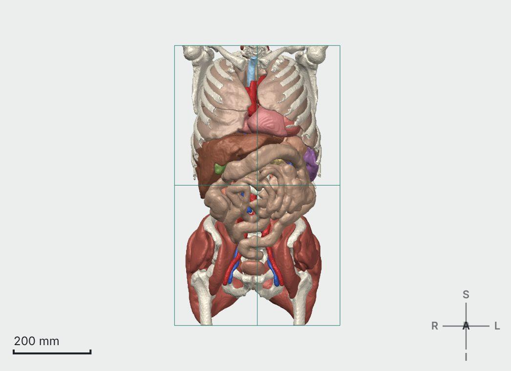 | 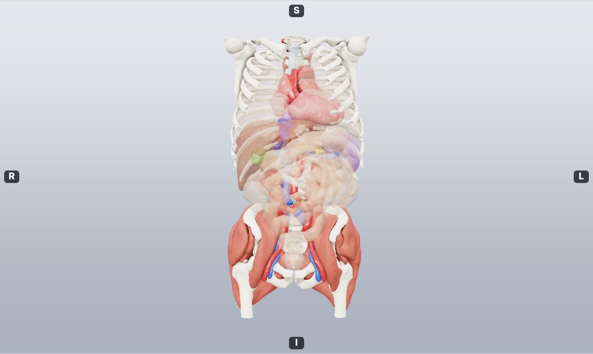 |

What changed: perspective instead of orthographic, translucent organs that show the vessels and spine behind them without milky sorting errors, ambient occlusion in the folds (ribs, pelvis), material differences (bone vs vessel vs muscle), and click/hover information.

**Desktop**

| | Light | Dark |
|---|---|---|
| Model | 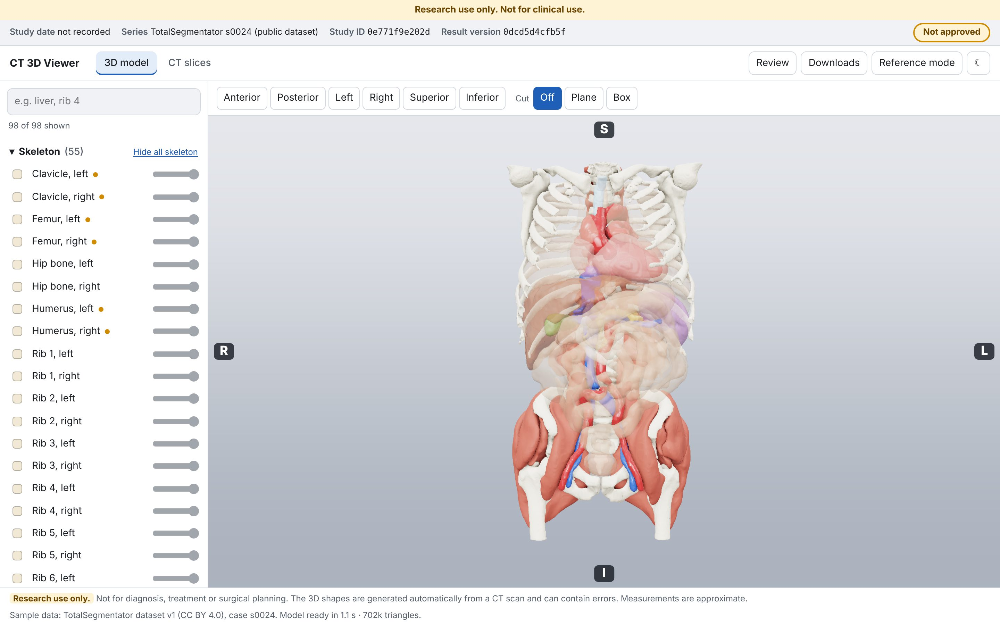 | 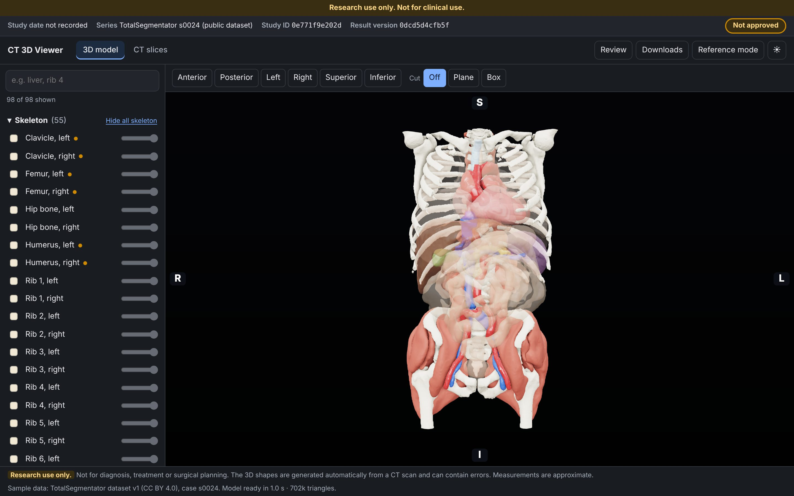 |
| Coronal cut with CT | 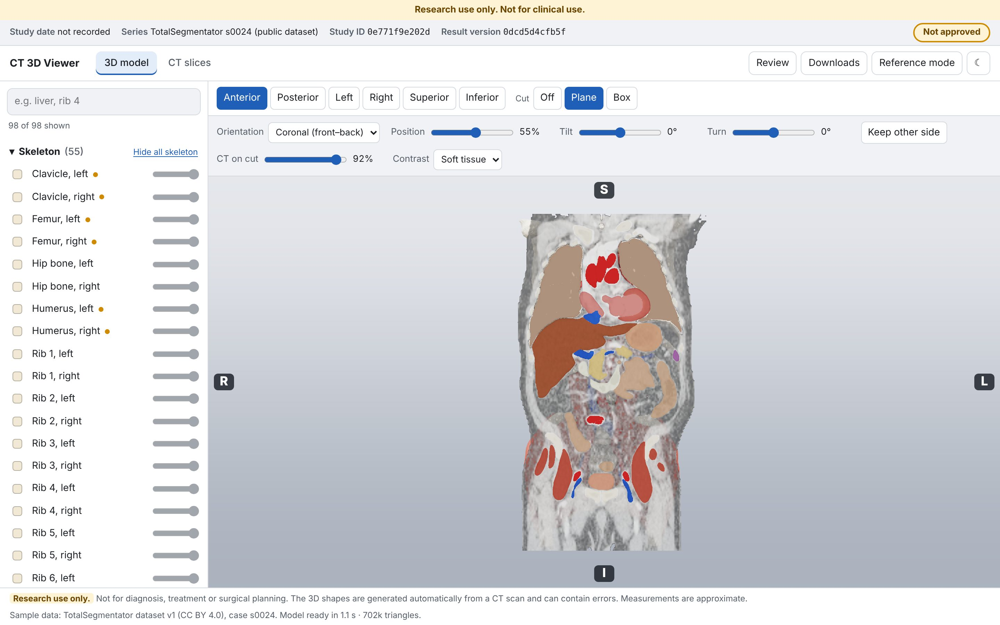 | 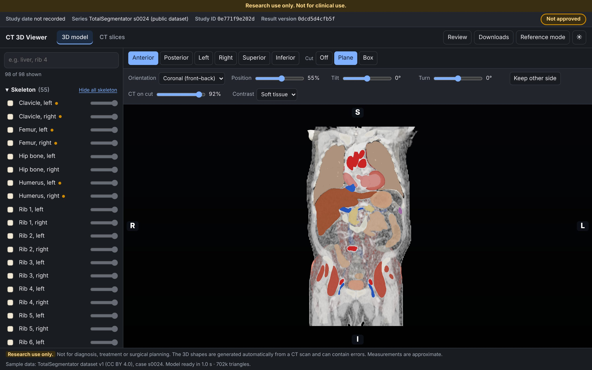 |
| CT slices with overlay | 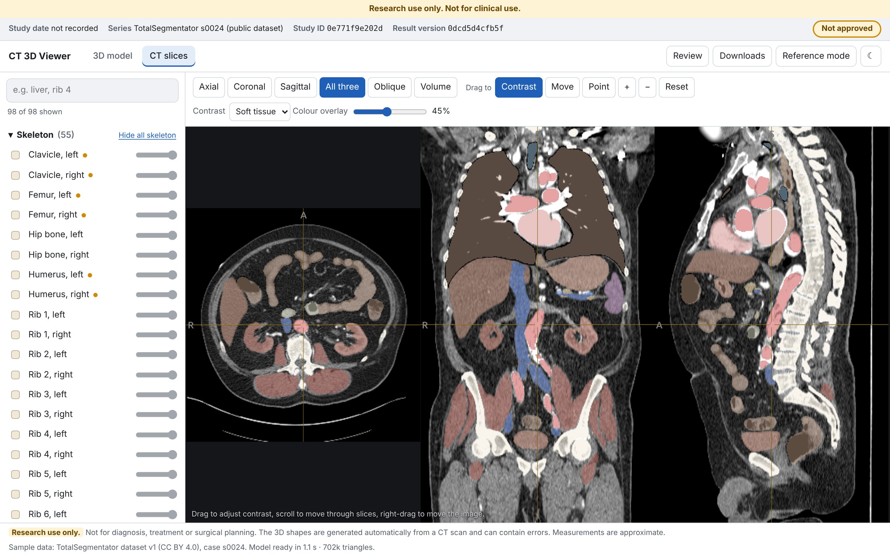 | 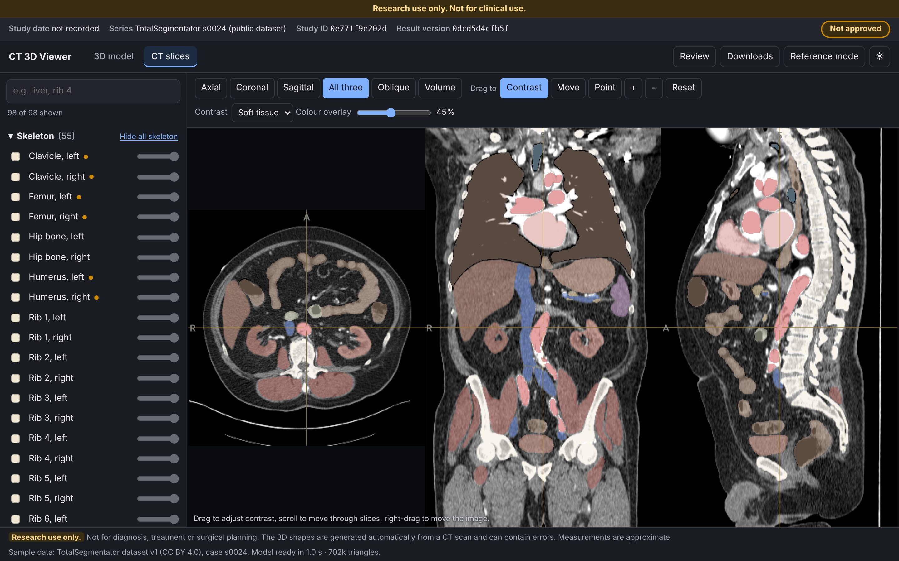 |
| Old viewer | 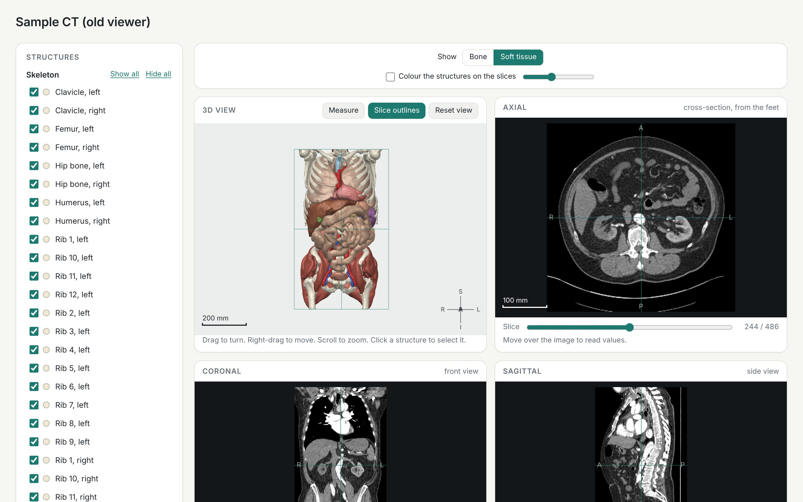 | 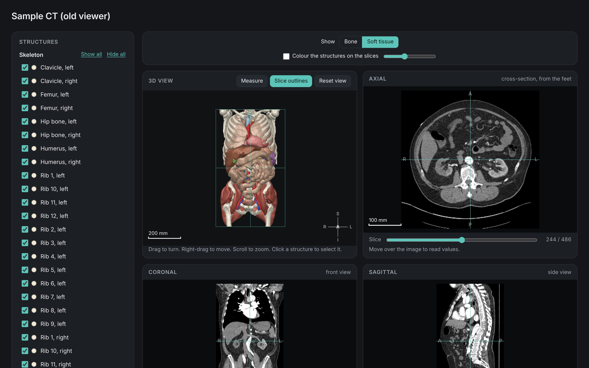 |

Volume rendering (bone window): 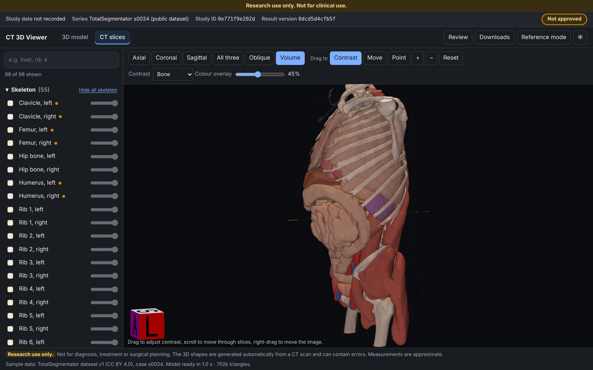

**Phone, 390 × 844**

| New, light | New, light, axial cut | New, dark | New, dark, list | New, dark, slices | Old, light | Old, dark |
|---|---|---|---|---|---|---|
| 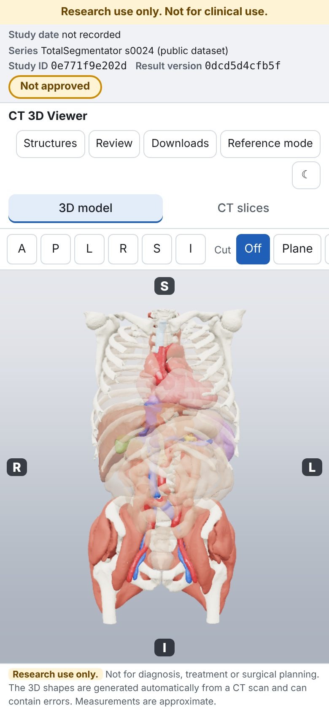 | 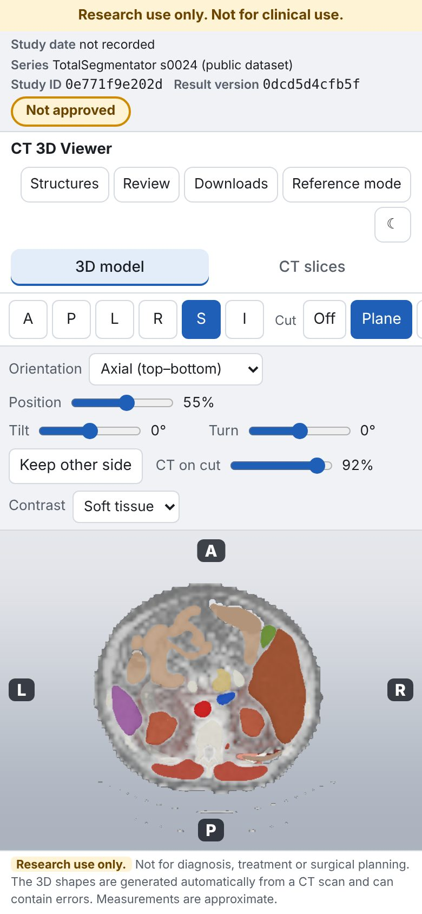 | 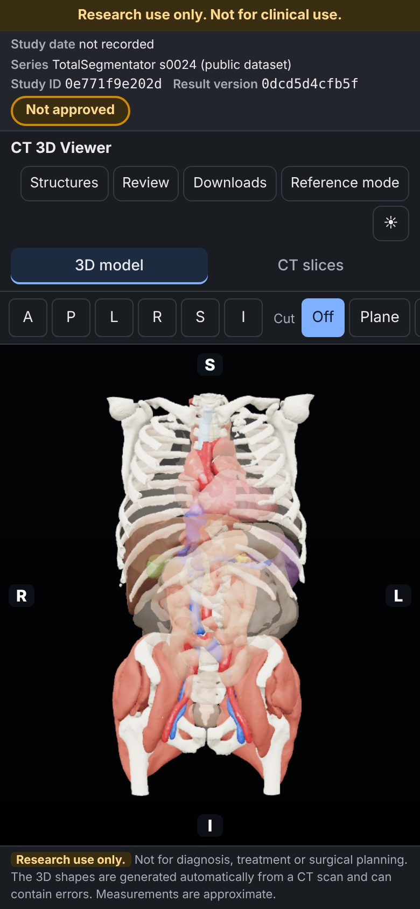 | 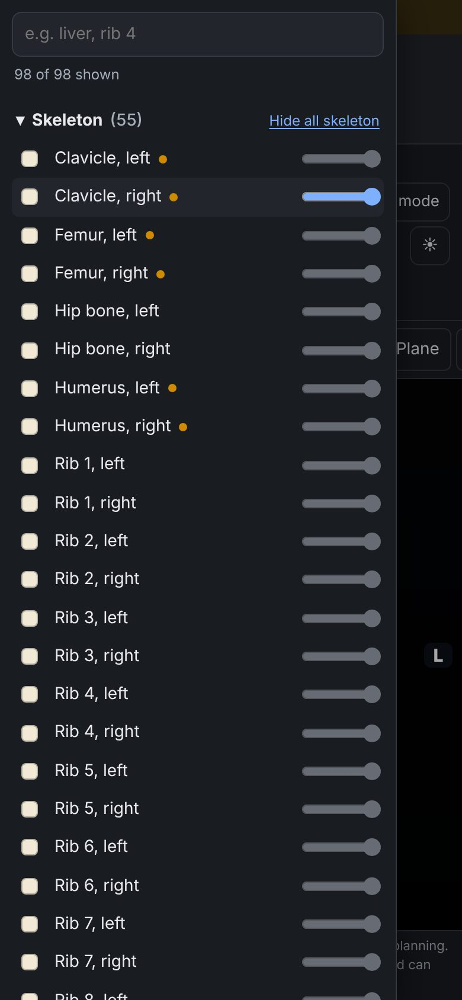 | 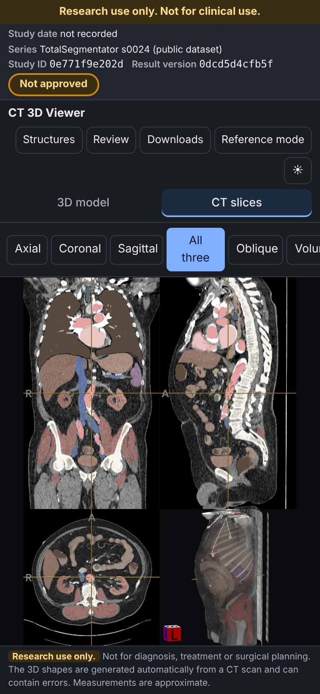 | 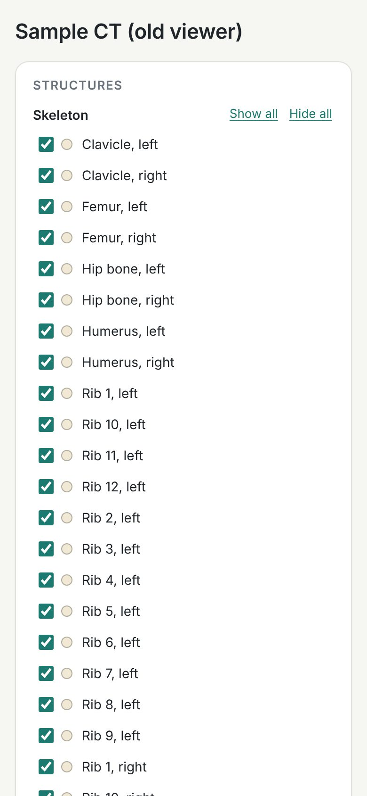 | 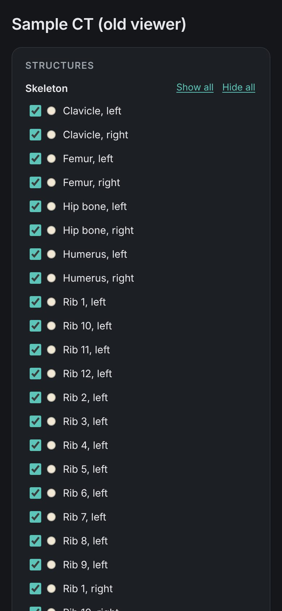 |

On a phone the old viewer opens on a long structure list; the 3D view is several screens down. The new one opens on the model.

## 5. Copy and accessibility

**Copywriting decisions** (all text is in `src/ui/copy.ts`):
- The research-use notice is in three places: a badge next to the product name, the footer on every view ("Not for diagnosis, treatment or surgical planning. The 3D shapes are generated automatically from a CT scan and can contain errors. Measurements are approximate."), and the page description.
- No diagnostic words: structures are "shapes", volumes are "approximate"; QC badges describe the model ("Cut by scan edge", "Surface has gaps", "Shape deviates up to 2.7 mm"), never the patient.
- "Cut by scan edge" explains itself: "Part of this structure lies outside the scan, so the flat end is the scan edge, not anatomy."
- No claim about where data is processed: the page never says the scan stays on the device (a test checks this).
- Window presets use plain names (Soft tissue, Bone, Lung, Vessels); "Contrast" instead of "window/level"; "Show on its own" instead of "isolate".
- Download text says STL/3MF are for printing in millimetres and must be checked before printing.

**Accessibility**
- Keyboard: skip link; all controls are native buttons, selects and range inputs with labels; the 3D view is focusable (arrows orbit, Shift = bigger steps, + / − zoom); Esc closes the info card, isolation and dialogs; the Downloads dialog is a native modal `<dialog>` with focus on Close.
- Contrast: a test computes the WCAG ratio of every visible text element in light and dark themes; all ≥ 4.5:1 (≥ 3:1 for large text).
- Reduced motion: camera transitions jump, orbit damping is off and CSS animations are disabled.
- Screen readers: the 3D view has a role description and usage text; loading and isolation are announced in a live region; colour swatches are decorative and every toggle has a name ("Hide Liver").
- Not covered yet: a screen-reader pass with NVDA/VoiceOver, and the CT image itself (NiiVue canvas) is not accessible beyond its label.

## 6. Tests

```
cd web/ct-viewer && npm run build && npx playwright test tests/smoke.spec.ts tests/a11y.spec.ts tests/device.spec.ts

  ✓   1 a11y › text contrast meets WCAG AA (light)
  ✓   2 a11y › text contrast meets WCAG AA (dark)
  ✓   3 a11y › keyboard: skip link, tabs, buttons and dialog
  ✓   4 a11y › reduced motion: preset changes jump without animation
  ✓   5 a11y › every control has an accessible name
model ready in 928 ms
  ✓   6 smoke › loads the model fast and without errors
  ✓   7 smoke › structure list: search, hide, show
  ✓   8 smoke › hover tooltip and click to isolate
  ✓   9 smoke › cut-by-scan-edge badge is shown
  ✓  10 smoke › clipping plane and box with CT on the cut
  ✓  11 smoke › camera presets and keyboard orbit
  ✓  12 smoke › CT slices: MPR, window presets, volume and oblique
  ✓  13 smoke › downloads use normal links that resolve
  ✓  14 smoke › phone (390 px) › usable at 390 px
  ✓  15 device › labelling banner and study identifiers are always shown
  ✓  16 device › missing study identifiers are flagged (wrong-patient hazard)
  ✓  17 device › models open as not approved; approval needs reviewer, slices and attestation
  ✓  18 device › any edit invalidates the approval and changes the version
  ✓  19 device › stale result › a changed result is not shown as approved
  ✓  20 device › orientation markers follow the camera (wrong-side hazard)
  ✓  21 device › reference mode: read-only, large targets, no hover-only controls
  ✓  22 device › reference mode works offline once saved
  22 passed (2.6m)
```

`npm run screenshots` (7 passed) regenerates every image in this file.

Python suite (`pytest -q` at the repo root): 506 passed, 4 skipped, 2 failed. The two failures (`test_acq_monitor_server.py::test_live_check_cues_markers_and_latency`, `test_viewer_js.py::test_csv_export_writes_missing_values_as_numbers`) fail the same way on the base commit without these changes; nothing in `src/` was modified.

## 7. Device groundwork (follow-up, 2026-11-22)

Added after the owner's decision to pursue a regulated device ([REGULATORY_PATH.md](../REGULATORY_PATH.md) §2 and §4). The use specification and the hazard list are in [device/S3_use_specification.md](../device/S3_use_specification.md).

| Request | What the viewer does now |
|---|---|
| Clinician sign-off | Every result opens **Not approved**. The Review panel takes a reviewer's name and role, requires the CT slices to have been opened and an explicit attestation, then approves the current **result version** = SHA-256 of the delivered manifest + web model + the list of corrections. Approval stores user, role, time, model hash, edits hash and version hash. Any change produces a new version, so the approval lapses at once ("invalidate" in the history); undoing back to the approved version restores it. |
| Editing | *Erase surface*: click a structure to remove the surface within a chosen radius (2–25 mm), recomputed from the original surface so undo is exact. *Exclude from model*: removes a whole structure. Every edit is listed with Undo and logged. |
| Records | Kept in this browser (localStorage, keyed by the model hash) and downloadable as JSON with the full history. A device needs a server-side, append-only audit trail and real sign-in; both are listed as open items. |
| Labelling | A persistent banner set at build time: "Research use only. Not for clinical use." (default) or "Investigational device: for use only in an approved clinical investigation." (`VITE_LABEL_STATUS=investigational`). Not switchable from the URL. No clinical claims in either. |
| Reference mode | `?mode=reference` or the header button: read-only (no edit, approval or download controls), black/white/yellow high-contrast palette, controls ≥ 48 px, no hover-only information (tap opens the info card), red **NOT APPROVED** bar when the version is not approved. *Save for offline use* caches the app (every built file, from a build-time asset list), the model and the CT through a service worker; the page then reloads and works with the network off. |
| Orientation | L/R/A/P/S/I letters on all four edges of the 3D and oblique views, from the camera every frame; NiiVue's orientation letters on the slices. |
| Study identifiers | Study date, series description, study ID (hash of the source CT) and result version on every screen; a red "Study details missing" message when the result has none. The manifest key `study` is proposed for S2; the sample has no real date (public data). |

| Not approved, after a correction | Approved |
|---|---|
| 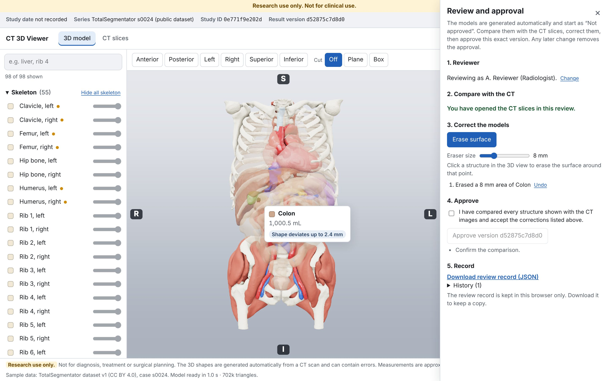 | 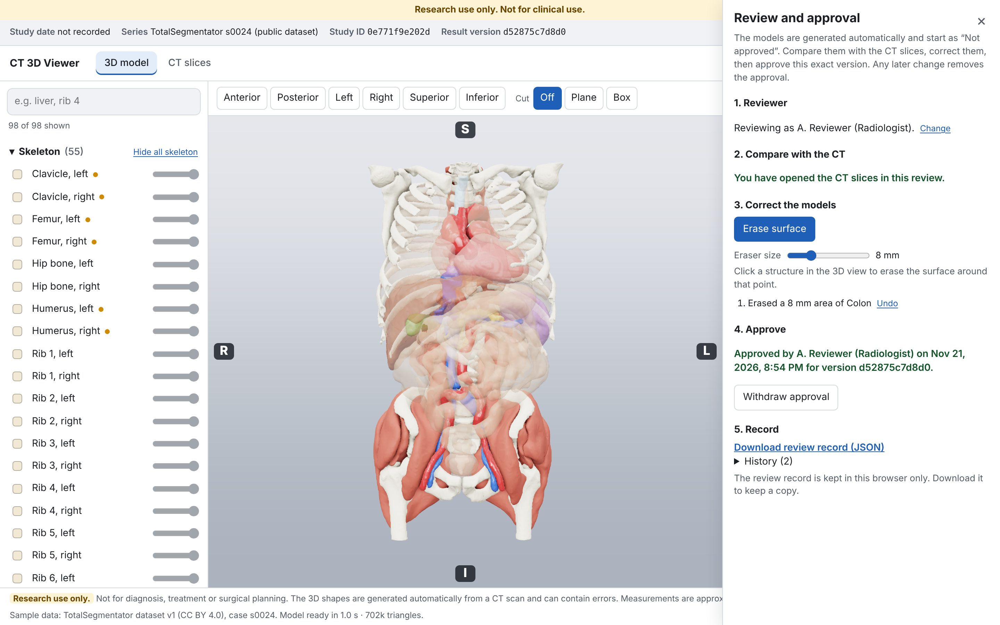 |

| Reference mode, desktop | Reference mode, phone | Investigational build banner |
|---|---|---|
| 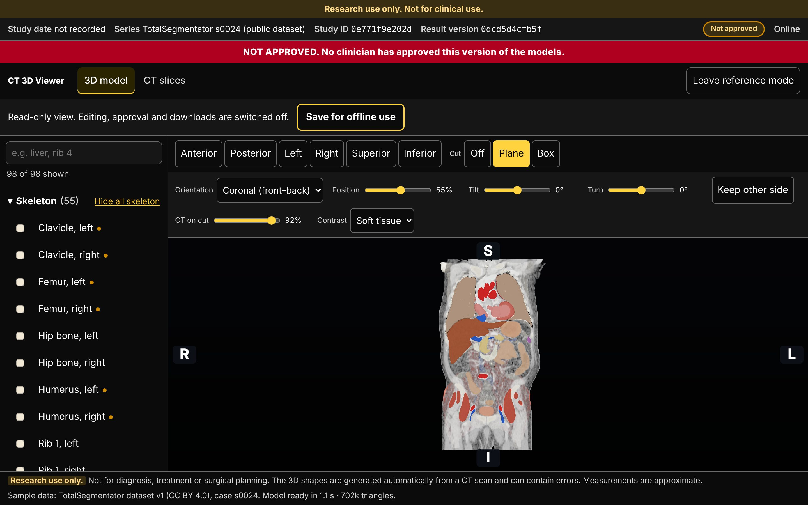 | 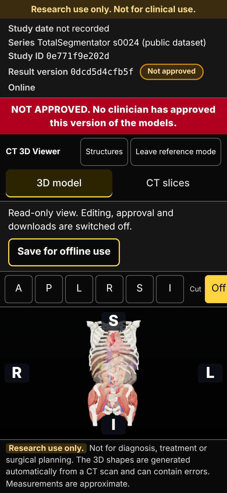 | 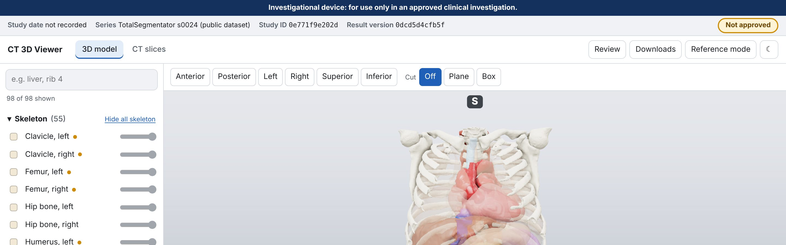 |

## 8. Known limits and next steps

- WebGL only. NiiVue is used through its WebGL2 build; WebGPU can be switched on later.
- Depth peeling costs N extra passes over translucent structures; 4 layers is plenty for this sample, but very dense translucent scenes may need 6.
- The 3D cut uses the ≤256-voxel CT preview (≈3 mm here); the slice view and the oblique view use the full CT.
- GTAO is computed from the opaque depth, so translucent organs do not cast occlusion.
- Measured only with software WebGL; real-device timing is still to do (section 3).
- The sample mesher is a stand-in; quality of the shapes is S2's job.
- On a phone in reference mode the label, identifier and NOT APPROVED bars take about half the screen; a compact form is needed before phones are used as reference screens.
- Device groundwork gaps (sign-in, server audit trail, export of corrected meshes, usability evaluation) are listed in the use specification, section 6.
